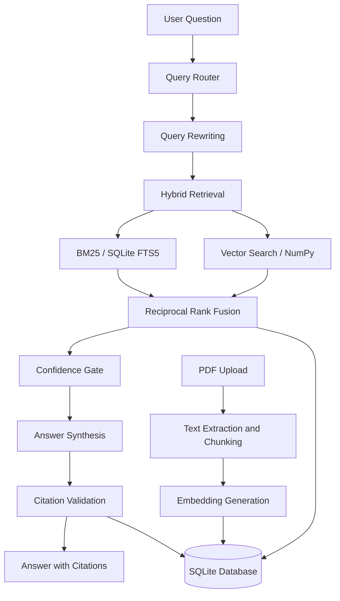

# PaperMind — Your Private AI Research Desk

**An offline AI research assistant that helps you search, understand, and analyze research papers with verifiable, page-level citations.**

PaperMind lets you chat with your research-paper library using locally running AI models. It combines hybrid retrieval, evidence-grounded answers, and retrieval evaluation to make research easier and more transparent.

Runs locally using [Ollama](https://ollama.com/), without requiring cloud inference API keys.

---

## Features

- **Page-level citations:** Connect answers to retrieved paper content and PDF pages.
- **Hybrid search:** Combine BM25 keyword search with semantic vector retrieval using Reciprocal Rank Fusion.
- **Evidence validation:** Validate citation markers against retrieved chunks and use a confidence gate when evidence is insufficient.
- **Pipeline traces:** Inspect rewritten queries, retrieved chunks, relevance scores, tool calls, and processing times.
- **Local model routing:** Use an 8B model for routing and lightweight tasks, and a 14B model for answer synthesis.
- **Retrieval evaluation:** Compare retrieval methods using Recall@k and Mean Reciprocal Rank (MRR), with optional LLM-based answer evaluation.

## Architecture



## Tech Stack

| Component         | Technology                   |
| ----------------- | ---------------------------- |
| Frontend          | React, Vite                  |
| Backend           | Python, FastAPI              |
| Local inference   | Ollama                       |
| Language models   | `qwen2.5:14b`, `llama3.1:8b` |
| Embedding model   | `nomic-embed-text`           |
| Keyword retrieval | SQLite FTS5 / BM25           |
| Vector retrieval  | NumPy cosine similarity      |
| Ranking           | Reciprocal Rank Fusion       |
| Database          | SQLite                       |
| Evaluation        | Python evaluation harness    |

## How It Works

1. **Document ingestion:** Upload a PDF, extract its text, split it into chunks, and generate embeddings.
2. **Query processing:** Classify the question, rewrite it when necessary, and retrieve relevant chunks using keyword and vector search.
3. **Result fusion:** Combine retrieval rankings using Reciprocal Rank Fusion.
4. **Answer generation:** Generate an answer grounded in retrieved evidence.
5. **Citation validation:** Validate citation markers against the retrieved content before storing the answer.
6. **Traceability:** Inspect retrieved chunks, scores, tool calls, and processing timings.

For complex requests, the assistant can use a tool loop with `search_corpus`, `list_papers`, `summarize_paper`, and `compare_papers`, capped at four steps.

## Evaluation

The supplied `eval/golden.json` contains 12 questions based on two research papers:

- [Attention Is All You Need](https://arxiv.org/pdf/1706.03762)
- [Deep Residual Learning for Image Recognition](https://arxiv.org/pdf/1512.03385)

Run retrieval evaluation:

```bash
python eval/run_eval.py
```

Run retrieval evaluation with the additional LLM-judge pass:

```bash
python eval/run_eval.py --judge
```

### Reported Results

Results reported for the supplied 12-question dataset, with `k = 8`:

| Retrieval Method | Recall@1 | Recall@3 | Recall@8 |   MRR |
| ---------------- | -------: | -------: | -------: | ----: |
| BM25             |    0.667 |    0.917 |    1.000 | 0.790 |
| Vector Search    |    0.333 |    0.750 |    0.917 | 0.579 |
| Hybrid Search    |    0.583 |    0.917 |    1.000 | 0.747 |

Reported LLM-judge scores using `qwen2.5:14b`:

- **Faithfulness:** 4.25 / 5
- **Answer quality:** 4.58 / 5

**Observation:** BM25 achieved the highest MRR on this keyword-heavy test set. Hybrid retrieval matched BM25's Recall@8 while incorporating semantic search, which may help with paraphrased queries.

These results apply to the supplied benchmark and are not universal performance guarantees. Evaluation runs are stored in the `eval_runs` table for comparison across configuration changes.

## Getting Started

### Prerequisites

- Python
- Node.js and npm
- [Ollama](https://ollama.com/) installed and running
- Sufficient memory for the selected local models

The original project reports testing on a MacBook M4 Pro with 24 GB unified memory. Performance will vary depending on hardware and model configuration.

### 1. Download the Models

```bash
ollama pull qwen2.5:14b
ollama pull llama3.1:8b
ollama pull nomic-embed-text
```

### 2. Set Up the Backend

Run these commands from the repository root:

```bash
python -m venv .venv
.venv/bin/pip install -e .
.venv/bin/uvicorn backend.main:app --port 8000
```

On Windows, use the corresponding executables under `.venv\Scripts\`, such as:

```powershell
.venv\Scripts\python.exe -m pip install -e .
.venv\Scripts\uvicorn.exe backend.main:app --port 8000
```

### 3. Start the Frontend

Open a second terminal:

```bash
cd frontend
npm install
npm run dev
```

Open the application at [http://localhost:5173](http://localhost:5173).

### 4. Use PaperMind

1. Upload a digital-text PDF.
2. Wait for its status to become `ready`.
3. Ask questions about your research papers.
4. Open a citation to navigate to the referenced PDF page.
5. Expand an answer's trace to inspect the retrieval pipeline.

To reproduce the supplied evaluation, upload both seed papers before running the evaluation commands.

## API Overview

| Method           | Endpoint               | Purpose                                         |
| ---------------- | ---------------------- | ----------------------------------------------- |
| `GET`            | `/health`              | Check Ollama connectivity and required models   |
| `POST`           | `/papers`              | Upload a PDF for ingestion                      |
| `GET` / `DELETE` | `/papers/{id}`         | Retrieve metadata or remove a paper             |
| `GET`            | `/papers/{id}/pdf`     | Serve a PDF for citation navigation             |
| `POST`           | `/papers/{id}/summary` | Generate and cache a summary                    |
| `POST`           | `/search`              | Perform hybrid retrieval                        |
| `POST`           | `/chats`               | Create a conversation                           |
| `GET`            | `/chats/{id}`          | Retrieve a conversation                         |
| `POST`           | `/chats/{id}/messages` | Stream responses using Server-Sent Events (SSE) |
| `GET`            | `/messages/{id}/trace` | Retrieve the pipeline trace                     |

## Tests

Run the test suite from the repository root:

```bash
.venv/bin/python -m pytest
```

The documented tests cover chunking invariants, Reciprocal Rank Fusion calculations, confidence-gate behavior, and citation validation.

## Design Decisions

- **SQLite instead of a separate vector database:** Keep document data and embeddings in one database.
- **Brute-force vector search:** Use NumPy cosine similarity without introducing an approximate-nearest-neighbor index for the intended corpus scale.
- **SQLite FTS5 for keyword search:** Provide lexical retrieval without another search service.
- **Direct Ollama integration:** Keep model interactions explicit without LangChain or LlamaIndex.
- **Local-first execution:** Run the application without a cloud inference service.

## Limitations

- Designed for a single local user; authentication is not included.
- Supports digital-text PDFs; OCR for scanned documents is not included.
- Does not require a separate vector database server.
- Does not require Docker for the documented local workflow.
- Requires local resources to run the selected language and embedding models.

## Project Structure

```text
.
├── backend/      # FastAPI backend and research pipeline
├── frontend/     # React + Vite interface
├── eval/         # Golden questions and evaluation scripts
├── tests/        # Automated tests
├── .vscode/      # Editor configuration
├── pyproject.toml
└── README.md
```

## Credits

PaperMind is the proposed name for a rebranded presentation of the ResearchMind codebase. Before publishing, check the original repository's license and attribution requirements, preserve required notices, and credit the original author where appropriate.

The evaluation figures in this README are reproduced from the supplied project description. Run the evaluation yourself before presenting them as independently verified results.

---

<div align="center">

**PaperMind — Your papers. Your machine. Answers you can verify.**

</div>
